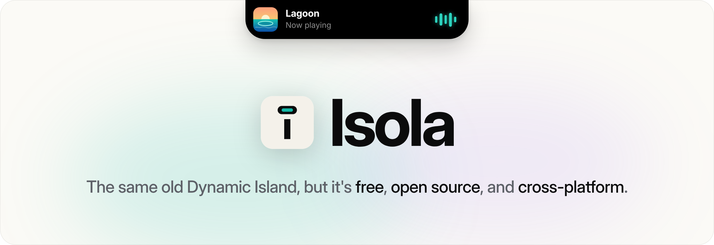

<p align="center">
  <picture>
    <source media="(prefers-color-scheme: dark)" srcset=".github/assets/banner-dark.png">
    
  </picture>
</p>

<p align="center">
  <a href="https://github.com/Natuworkguy/Isola/releases/latest"></a>
  <a href="https://github.com/Natuworkguy/Isola/actions/workflows/build.yml"></a>
  
  
</p>

<p align="center">
  <a href="#download"><b>Download</b></a> &nbsp;·&nbsp;
  <a href="#features"><b>Features</b></a> &nbsp;·&nbsp;
  <a href="#notifications"><b>For developers</b></a> &nbsp;·&nbsp;
  <a href="#build-and-run"><b>Build</b></a> &nbsp;·&nbsp;
  <a href="Windows/README.md"><b>Windows</b></a>
</p>

<p align="center">
  Isola puts a Dynamic Island at the top of your Mac or PC.<br>
  Music, widgets, Live Activities, your files and your clipboard, one glance away.
</p>

<br>

<table align="center">
  <tr>
    <td align="center" width="33%"><b>Home</b><br><sub>25 live widgets you arrange right in the island</sub></td>
    <td align="center" width="33%"><b>Live Activities</b><br><sub>Timers that ring, privacy dots, drives, downloads and more</sub></td>
    <td align="center" width="33%"><b>Media</b><br><sub>Whatever is playing, with artwork and controls</sub></td>
  </tr>
  <tr>
    <td align="center"><b>File Tray and Basket</b><br><sub>Drop files in, or shake one to zip, convert or share it</sub></td>
    <td align="center"><b>Clipboard</b><br><sub>Everything you copied, as cards you can search</sub></td>
    <td align="center"><b>Glass or black</b><br><sub>Floating or attached, notch or no notch</sub></td>
  </tr>
</table>

## Download

<table align="center">
  <tr>
    <th>Mac</th>
    <th>Windows (Intel and AMD)</th>
    <th>Windows on ARM</th>
  </tr>
  <tr>
    <td align="center"><a href="https://github.com/Natuworkguy/Isola/releases/latest"><code>Isola-macOS.dmg</code></a></td>
    <td align="center"><a href="https://github.com/Natuworkguy/Isola/releases/latest"><code>Isola-Windows-x64-Setup.exe</code></a></td>
    <td align="center"><a href="https://github.com/Natuworkguy/Isola/releases/latest"><code>Isola-Windows-arm64-Setup.exe</code></a></td>
  </tr>
  <tr>
    <td align="center"><sub>macOS 14 or later, Apple silicon and Intel</sub></td>
    <td align="center"><sub>Windows 10 and 11</sub></td>
    <td align="center"><sub>Windows 11</sub></td>
  </tr>
</table>

On the Mac, open the disk image and drag Isola to Applications. The Mac app is Swift, SwiftUI and AppKit. It is not
notarised, so the first time, right-click it and choose Open. On Windows, the installer needs no administrator rights
and adds Isola to the Start menu, with an uninstaller in Settings, Apps. The Windows app is C# and WPF, a single
self-contained `Isola.exe`, also in a zip to run without installing; see [Windows/](Windows/README.md) for everything
specific to it.

## Works on every Mac

- **Notched MacBooks:** the island grows out of the hardware notch.
- **iMac, Studio Display, external monitors (no notch):** a virtual island. Choose a pill attached to the top edge or
  a capsule floating in the menu bar, in Dynamic Glass or solid black, how big it is when idle, and whether it hides
  until you reach for it.
- **Several displays:** pin it to the notched or main display, or let it follow the pointer.

## Features

- **Home:** a row of live widgets, and a pencil that arranges them right in the island. The widgets shrink with dashed
  outlines; drag them into a new order, or drag new ones up from the gallery. 25 widgets: clock, analog clock, world
  clock, now playing, weather, battery, system graphs, network speed, storage, uptime, next event, today, month,
  day and year progress, timer, Focus sessions, stopwatch, clipboard, File Tray, shortcuts, Keep Awake, moon phase,
  dice, counter and a colour picker. Separators, as many as you like, split them into groups.
- **Media:** whatever macOS reports as now playing: Music, Spotify, podcasts, VLC, and videos in Safari, Chrome and
  other browsers. Artwork, the source app, a draggable seek bar and transport controls, and a card for each app when
  several play. Pop it out into a floating player that stays on the desktop, on every Space.
- **Live Activities:** the island answers what is happening on your Mac.
  - Volume and brightness as a bar beside the notch.
  - Timers and alarms ring in the island with Stop and Repeat or Snooze: Isola's own Timer and Focus sessions, and
    the Clock app's alarms and timers, whose banner Isola moves out of sight.
  - A running timer, Focus session or stopwatch counts in the ears.
  - Green and orange privacy dots while the camera or microphone is in use.
  - Banners for charging and battery, headphones and AirPods (with battery), drives (with Eject), VPNs, downloads
    finishing, screenshots and screen recordings, going offline and coming back, displays, Caps Lock, the keyboard
    layout, meetings about to start, low storage and Focus.
  - Each has its own switch. Optionally Isola takes over the volume, mute and brightness keys so the macOS overlay
    never appears.
- **Live Activities from anything:** apps and scripts can start their own activity with a checklist that ticks off
  in place, a progress ring or a countdown, using `isola://activity` links. See
  [Live Activities from anything](#live-activities-from-anything).
- **File Tray:** drop files in, drag them back out, AirDrop or share them, zip them to Downloads, or convert images.
  `open -a Isola report.pdf` adds a file from the command line. Files are never moved or copied.
- **Basket:** shake a file while you drag it and a drop target appears right at the pointer: Tray, AirDrop, Convert
  or Zip, without dragging all the way up to the island.
- **Clipboard:** text, links, colours and images you copy, as preview cards you can search. Click one to copy it
  again. Concealed copies from password managers are skipped.
- **Calendar** and **System** tabs: your next events, and CPU, memory, disk and battery gauges.
- **Gestures and a shortcut:** swipe down on the island to open it and up on its top edge to close it, swipe sideways
  over the music to skip tracks, or press Control-Option-A from anywhere.
- **Look:** Dynamic Glass or solid black, in every style: floating in the menu bar or attached to the top edge.
  Dynamic Glass blurs and takes on the colour of whatever is behind the island; on macOS 26 it is the system's own
  `glassEffect`. A tab highlight that glides between tabs, and an ambient glow taken
  from the album art.
- **Notifications from anything:** apps and scripts can show a short banner with an `isola://notify` link. See
  [Notifications](#notifications).

Everything is configurable under the menu bar icon, Settings. Opening Isola again from Applications, Launchpad or
Spotlight opens Settings too, with a Dock icon while it is open. On a Mac with Screen Time limits, that window is where
macOS asks for more time, and opening it once puts Isola in Screen Time's list of apps, so it can be Always Allowed.

### What it won't do

Isola never sends your clipboard, files or music anywhere. The Weather widget is the one thing that goes online: it
asks a public service for a rough location from your network address, then Open-Meteo for the forecast, and only when
it is on your Home tab. macOS gives apps no way to read other apps' notifications or the current Focus, so Clock
alerts use Accessibility and Focus needs Full Disk Access; Settings says so beside each, and both are optional.

## Build and run

```bash
cd Isola/macOS
./build_app.sh
open build/Isola.app
```

Works with the Xcode Command Line Tools alone. `UNIVERSAL=1 ./build_app.sh` makes an arm64 + x86_64 build,
`VERSION=1.2.0` stamps a version, `ZIP=1` also writes `build/Isola-macOS.zip`, and `DMG=1` the installer,
`build/Isola-macOS.dmg`, laid out by [dmgbuild](https://github.com/dmgbuild/dmgbuild) over a background drawn in
`Resources/DMGBackground.html` (`Resources/render_dmg_background.py` renders it again after a change). The Windows app builds with `Windows/build.ps1`, or `Windows/build.sh` from Linux or macOS.

The build downloads a pinned commit of [mediaremote-adapter](https://github.com/ungive/mediaremote-adapter)
(BSD-3-Clause), compiles it with `clang`, and bundles it in `Isola.app/Contents/Resources/Adapter`. It is how the
Media tab reads system-wide Now Playing on macOS 15.4 and later, by running Apple's own `/usr/bin/perl`. At launch
Isola tests it, and if it does not work (or could not be built) it falls back to polling Music and Spotify only.

macOS may ask for permission to control Music or Spotify (only used for that fallback), to read your calendar, to use
Bluetooth (only to notice headphones connecting), to see your Downloads and Desktop folders (only to notice downloads
and screenshots arriving), and for Accessibility (the media keys and Clock alerts). All are optional.

## Notifications

Open an `isola://notify` link and the island grows into a banner for a few seconds. From a script:

```bash
open -g "isola://notify?title=Build%20done&text=All%20tests%20pass&symbol=checkmark.circle.fill&color=green"
```

`-g` keeps whatever you are doing in front. Encode spaces as `%20` (or `+`).

| Parameter | Meaning |
| --- | --- |
| `title` | First line, bold. |
| `text` | Second line. With no title it becomes the only line. |
| `symbol` | Any [SF Symbol](https://developer.apple.com/sf-symbols/) name. Default `bell.fill`. |
| `color` | `red`, `orange`, `yellow`, `green`, `mint`, `teal`, `cyan`, `blue`, `indigo`, `purple`, `pink`, `brown`, `gray`, or hex like `ff9500`. Default mint. |
| `duration` | Seconds on screen, 1 to 30. Default 4. |
| `sound` | A macOS sound, such as `Glass`, `Ping` or `Hero`. Default none. |

Click the banner to put it away. Since any app can open the link, a banner only ever shows text: no buttons, links or
actions. Banners can be switched off in Settings, Island, Notifications.

## Live Activities from anything

Open an `isola://activity` link to start a Live Activity, open the same id again to update it in place, and end it
when you are done:

```bash
open -g "isola://activity?id=build&title=Build&subtitle=Release&symbol=hammer.fill&color=orange&steps=done:Fetch|active:Compile|todo:Test"
open -g "isola://activity?id=build&steps=done:Fetch|done:Compile|active:Test&progress=0.66"
open -g "isola://activity/end?id=build"
```

The activity sits in the ears beside the notch. When it starts, and each time its steps change, it grows into a card
for a few seconds: its icon, title and subtitle, then the steps as a checklist, done ones ticked and the current one
playing. Click the island to see the card again.

An activity can hold a conversation instead, as it goes: `lines` lists who said what, and each time it changes the
card shows the latest three, the newest brightest and the activity's own speaker (the one its `title` names) in its
colour. Send the whole conversation each time, and the words still being said as its last line, with `mic=talking`
while someone speaks into it:

```bash
open -g "isola://activity?id=talk&title=Flash&symbol=waveform&color=d97757&mic=listening&lines=You:what's%20on%20today|Flash:Two%20meetings,%20at%2010%20and%203."
```

| Parameter | Meaning |
| --- | --- |
| `id` | Required: letters, digits, `.`, `-` and `_`, up to 64. The same id updates the activity. |
| `title`, `subtitle` | The card's header. The subtitle follows a dot, in the activity's colour. |
| `symbol`, `color` | As for notify. Default `sparkles` and mint. |
| `steps` | Up to 12, separated by `\|`, each `done:`, `active:`, `todo:` or `failed:` and its text. |
| `lines` | A conversation: up to 6, separated by `\|`, each a speaker, `:`, and what they said. Shown instead of steps. |
| `progress` | 0 to 1: a ring in the ears and a bar on the card. Empty clears it. |
| `trailing` | Up to 8 characters for the right ear, such as `2/5`. |
| `countdown`, `elapsed` | Seconds: count down to zero, or up from that many, in the ears. Empty clears. |
| `priority` | `low` lets music keep the ears while this runs. |
| `mic` | `talking`, `listening`, `on` or `off`: the activity is using the microphone, so Isola's own orange dot and "Microphone in use" banner stay away while it runs. While `listening` or `talking`, live bars take the place of its icon, calm while it waits and lively while you speak. |
| `peek` | `1` shows the card now, `0` keeps it in the ears. By default it shows when the steps or lines change. |

Only the parameters you give change. An activity ends on its own after two hours without an update, and at most
eight from links run at once. Like notify links, activities only ever show text. They can be switched off in
Settings, Island, Notifications. [flash-isola](https://github.com/Natuworkguy/flash-isola) uses this to show
[Flash](https://github.com/Natuworkguy/Flash)'s plan as a live checklist, and a "Hey Flash" conversation as it is
spoken.

## Releases and contributing

`main` is the current stable release; `dev` holds everything since. Contributions go in as pull requests into `dev`,
and a release is a pull request from `dev` into `main`, tagged from `main`. GitHub Actions builds both apps on every
push and pull request, and the **Release** workflow publishes the tagged version with its installers and zips attached. See
[CONTRIBUTING.md](CONTRIBUTING.md).

<details>
<summary><b>Where everything lives</b></summary>
<br>

| Folder | What |
| ------ | ---- |
| `macOS/` | The Mac app: Swift, SwiftUI and AppKit, built with `macOS/build_app.sh` |
| `Windows/` | The Windows app: C# and WPF on .NET 8, built with `Windows/build.ps1` (or `build.sh`) |

In `macOS/Sources/Isola`:

| File | Role |
| --- | --- |
| `main.swift`, `AppDelegate.swift` | Entry point, menu bar item, settings window |
| `Prefs.swift` | Preference keys, defaults and option enums |
| `AppState.swift` | Shared state and the list of tabs |
| `NotchController.swift` | Panel placement, notch and notchless layout, pointer polling |
| `IslandView.swift`, `IslandChrome.swift` | Island shape, glass material, tab bar, collapsed live activity |
| `NowPlayingMonitor.swift`, `NowPlayingView.swift` | Media tab state and UI, AppleScript fallback |
| `MediaRemoteStream.swift` | Bridge to the bundled adapter: stream, play/pause, skip, seek |
| `FileTray.swift`, `TrayView.swift` | File tray |
| `FileActions.swift` | AirDrop, image conversion and zip, shared by the tray and the Basket |
| `Basket.swift` | The drop target that appears when a dragged file is shaken |
| `ClipboardMonitor.swift`, `ClipboardView.swift` | Clipboard history: text, links, colours and images, with search |
| `CalendarMonitor.swift`, `CalendarView.swift` | EventKit |
| `SystemStats.swift`, `SystemView.swift` | System gauges |
| `SettingsView.swift` | Settings window |
| `MediaKeys.swift` | Optional takeover of the volume and brightness keys, hiding the macOS overlay |
| `LiveActivities.swift` | Volume, brightness, power, headphones, drives and VPN, shown as a bar or a banner |
| `SystemActivities.swift` | Camera and microphone, downloads, screenshots, network, displays, Caps Lock, keyboard, meetings, storage, Focus, Clock alerts |
| `ActivityViews.swift` | Live Activities in the ears, their cards and the privacy dots |
| `HomeView.swift`, `HomeWidgets.swift` | The Home tab, arranging it, and every widget |
| `HotKey.swift` | The keyboard shortcut |
| `FloatingPlayer.swift` | The floating player window |
| `Notify.swift` | `isola://notify` and `isola://activity` links, and the banners they show |
| `MemoryGuard.swift` | The memory limit: caches go, then a fresh copy of Isola, if it ever uses too much |

</details>

<br>

<p align="center"><sub>Made by Natuworkguy. Free and open source, for Mac and PC.</sub></p>
